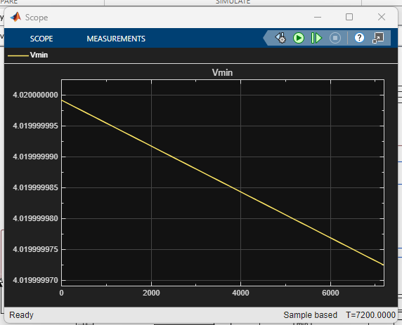

# Passive Cell Balancing of a 4S Battery Pack (Simulink / Simscape)

A Simulink / Simscape model of four lithium-ion cells in series with passive balancing: a bleed resistor and a switch across each cell. Built as Day 10 of a 30-day self-study plan on battery management systems.

Author: Ali Sher

## Idea
In a series string every cell carries the same current, so a cell that is fuller than the others reaches the upper voltage limit first and limits the whole pack. Passive balancing fixes this by discharging the fuller cells through a resistor until they match the lowest cell. The extra charge is dissipated as heat.

## Model
- 4 cells in series, each a Battery (Table-Based) block: 3 Ah, R0 = 20 mOhm, OCV from 3.0 V (0 %) to 4.2 V (100 %)
- Initial SOC of the cells: 88 %, 86 %, 84 %, 82 % (an unbalanced pack at rest, no load)
- A 33 ohm bleed resistor and a switch across each cell (about 0.12 A and 0.5 W per resistor at 4 V)
- Control for each cell: the cell voltage minus the lowest cell voltage (MinMax block) goes into a relay. The switch closes above 12 mV and opens below 8 mV. The hysteresis band keeps the switch from chattering.
- Solver: variable-step ode23t, stop time 7200 s

## Results
**State of charge.** Cells 1, 2 and 3 are discharged through their resistors until they reach the lowest cell. Cell 3 stops at about 800 s, cell 2 at about 2600 s and cell 1 at about 4350 s. Cell 4 is already the lowest, so its switch never closes. The SOC spread falls from 6 % (88 % to 82 %) to about 1 %.

**Lowest cell voltage (Vmin).** It stays at 4.02 V, because it follows cell 4, which is never bleeding. The scope axis in this screenshot is zoomed in to a change of a few nanovolts, so the line looks like it falls, but the change is numerical noise.

## What it shows
1. Passive balancing brings the fuller cells down to the lowest cell, and the pack ends at the level of its weakest cell.
2. It is slow. A bleed current of about 0.12 A (C/25) needed about 75 minutes to remove a 5 % mismatch.
3. It is wasteful. About 0.27 Ah (roughly 1 Wh) was removed from cells 1 to 3 and turned into heat.
4. The cells stop slightly above the 8 mV off point (about 10 mV above the lowest cell). A bleeding cell's terminal voltage is lowered by the drop across its internal resistance (about 0.12 A x 20 mOhm = 2.4 mV), so the controller sees the cell as lower than its open-circuit voltage.

## How to run
Open `day10_passive_balancing.slx` in MATLAB with Simulink, Simscape, Simscape Electrical, and Simscape Battery. Set the stop time to 7200 s, and run.

## Limitations
- Balancing at rest only, with no load or charger
- R0-only cells, no RC dynamics, no temperature or aging
- Ideal switches and resistors, with no heat model for the bleed resistors
- Cell voltages are measured while the bleed current flows, which adds a small error

## Next steps
- Balance during charging, with a CC-CV charger
- Compare with active balancing
- Add protection limits (over-voltage, under-voltage) and a thermal model for the resistors
